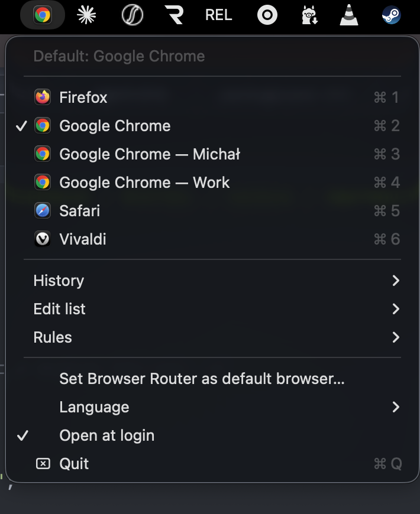

# Browser Router

**A menubar app that decides which browser — and which browser profile — every link on
your Mac opens in.** Free, open source, no popup asking you every single time.

<p align="center">
  
</p>

## Quick start

```sh
brew install --cask mi4uu/tap/browser-router
```

or, without Homebrew — downloads the latest release into `~/Applications`, registers it as
a browser and launches it:

```sh
curl -fsSL https://raw.githubusercontent.com/mi4uu/macos-browser-router/main/install.sh | bash
```

Then, in the menubar menu: **Set Browser Router as default browser…**, confirm the macOS
dialog, and pick the browser your links should open in. That is the whole setup.

## The problem

You have more than one browser, or one browser with a work profile and a private profile.
macOS does not care: it sends every link to one default browser, and you spend your day
dragging URLs from the wrong window into the right one.

The usual fix is a picker app that pops up a little window on every click so you can
choose. That trades one annoyance for another — now every link is a decision, the popup
steals focus, and if you click away it vanishes and the link is simply gone. I used
[Browserosaurus](https://github.com/will-stone/browserosaurus) and that last part is what
finally broke me: links quietly disappearing because the picker lost focus.

The apps that solve it properly — Choosy, Bumpr, OpenIn — are paid. Velja is free but
closed source. So: Browser Router. Free, AGPL, roughly 600 lines of Swift, no dependencies.

## What it does

**One default, changed in one click.** The menubar icon *is* the icon of the browser your
links currently go to. Click it, pick another one, done. ⌘1…⌘9 for the first nine.

**Profiles are first-class.** Chrome, Brave, Edge, Vivaldi, Chromium and Chrome Canary
profiles each get their own entry — `Google Chrome — Work` is a target just like Safari
is. Nothing to configure: profile names are read from the browser itself, so a profile you
add tomorrow shows up on its own.

**Rules, when you want them.** A plain text file, one rule per line, no regex:

```
https://github.com/*   -> chrome work
https://*.slack.com/*  -> safari
Slack                  -> chrome work
Mail                   -> safari
```

A pattern with `://` matches the URL. Without it, it matches the app the link came from.
`*` matches anything. First match wins; anything unmatched goes to the browser ticked in
the menu.

Browser names are forgiving on purpose. `chrome work` finds `Google Chrome — Work`,
`michal` finds `Google Chrome — Michał`, and typos are tolerated: `chrom work`, `safri`
and `vivladi` all resolve. A name that matches nothing gets a ⚠ in the Rules menu instead
of silently doing nothing.

**History that answers "where did that link go?"** Every link is logged as
`app → page → browser`, with ⚙ marking the ones a rule decided. Click an entry to reopen
it. Also on disk as JSON Lines, so it is greppable.

```
20:36   Slack → github.com → Google Chrome — Work   ⚙
20:11   Mail → tickets.example.com → Safari
```

<p align="center">
  
</p>

**Editable list.** Terminals and IDEs register themselves as URL handlers, so macOS lists
them as "browsers". Untick them in **Edit list** and they are gone.

**English and Polish**, following your macOS language by default, switchable in the menu.

## Install

macOS 14 or newer. Releases are universal binaries, so Apple Silicon and Intel both work.

**Option A — Homebrew**

```sh
brew install --cask mi4uu/tap/browser-router
```

**Option B — the install script**

```sh
curl -fsSL https://raw.githubusercontent.com/mi4uu/macos-browser-router/main/install.sh | bash
```

**Option C — download the app**

Grab the `.zip` from [Releases](https://github.com/mi4uu/macos-browser-router/releases),
unzip it into `~/Applications`, then clear the quarantine flag so macOS will open it:

```sh
xattr -dr com.apple.quarantine ~/Applications/"Browser Router.app"
```

**Option D — build from source** *(needs Xcode Command Line Tools)*

```sh
git clone https://github.com/mi4uu/macos-browser-router.git
cd macos-browser-router
./build.sh          # compiles, signs, installs to ~/Applications, registers it
open -a ~/Applications/"Browser Router.app"
```

### Why the quarantine step

Releases are built by GitHub Actions and signed ad-hoc, not notarized by Apple —
notarization needs a $99/year developer account and this project is free. macOS therefore
quarantines the downloaded app, and options A, B and C clear that flag — the Homebrew cask
does it in a `postflight` block you can read in
[the tap](https://github.com/mi4uu/homebrew-tap/blob/main/Casks/browser-router.rb).
Building from source (option D) never sets the flag in the first place, and produces the
same universal app from the same script CI runs.

## Files

`~/Library/Application Support/BrowserRouter/`

| File | What is in it |
| --- | --- |
| `config.json` | current target, hidden entries, menu language |
| `rules.txt` | routing rules, re-read on every link |
| `history.jsonl` | one JSON object per opened link |

## Building

`./build.sh` builds for your machine and installs it. `./release.sh 1.2.3` builds the
universal, versioned bundle and zips it into `dist/` — the same script GitHub Actions runs
for every push and every `v*` tag. Tagging `v1.2.3` publishes the release;
`./scripts/bump-cask.sh 1.2.3` then points the Homebrew cask at it.

## How it works

The app declares itself an `http`/`https` handler and runs as a menubar-only agent
(`LSUIElement`). When macOS hands it a URL it checks the rules, then opens the URL in the
chosen app — via `NSWorkspace` normally, or via the Chromium `--profile-directory` command
line when the target is a specific profile.

The app a link came from is the frontmost app at the moment the URL arrives — the same
heuristic Browserosaurus uses. It is right in practice, not guaranteed.

Other picker apps (Browserosaurus, Velja, Choosy, Finicky) are filtered out of the target
list so links cannot bounce between routers.

## Translations

English is the source language: the keys in `Sources/L10n.swift` *are* the English
strings, so a new language is one entry in `L10n.tables` and one line in `L10n.available`.
Pull requests very welcome.

## Support this

Browser Router is free and will stay free. If it saves you the daily annoyance it was
built to remove, you are welcome to buy me a coffee:

- [GitHub Sponsors](https://github.com/sponsors/mi4uu)
- [paypal.me/mi4uuuu](https://paypal.me/mi4uuuu)

Entirely optional. Bug reports and translations are just as valuable.

## License

[AGPL-3.0](LICENSE)
