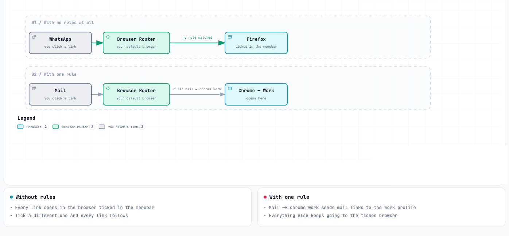
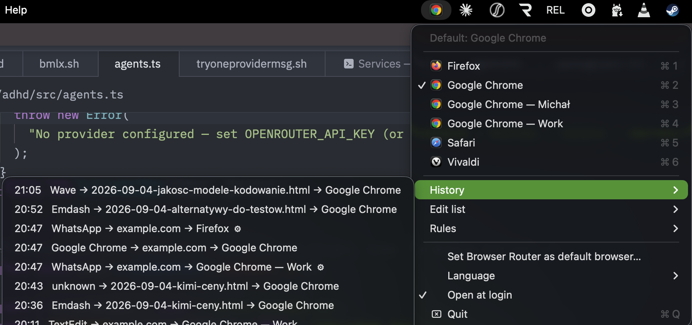

<h1 align="center">Browser Router</h1>

<p align="center">
  <b>One click in the menubar decides which browser every link on your Mac opens in.</b><br>
  Free, open source, and no popup asking you the same question forty times a day.
</p>

<p align="center">
  
</p>

```sh
brew install --cask mi4uu/tap/browser-router
```

---

## The one thing it does

The menubar icon **is** the browser your links open in. Click the icon, pick a different
browser, and from that moment every link goes there — from Slack, from Mail, from your
terminal, from anywhere.

That is the whole app. No window, no popup, no decision per link.

Two things make it more useful than switching the default in System Settings:

- **It is instant.** One click instead of System Settings → Desktop & Dock → scroll → dropdown.
- **Browser profiles count as browsers.** `Google Chrome — Work` sits in the list next to
  Safari, so "send everything to my work profile for the next hour" is also one click.
  Profiles are read from the browser itself: add one tomorrow and it appears on its own.

## The problem it solves

You have a work browser and a private browser, or one browser with two profiles. macOS
does not care — every link goes to one default, and you spend the day dragging URLs from
the wrong window into the right one.

The usual fix is a picker that pops up on every click so you can choose. That trades one
annoyance for another: now every link is a decision, the popup steals focus, and if you
click away it disappears and the link is simply gone. I used
[Browserosaurus](https://github.com/will-stone/browserosaurus), and that last part is what
finally broke me — links quietly vanishing because the picker lost focus.

The apps that solve it properly — Choosy, Bumpr, OpenIn — are paid. Velja is free but
closed source. So: Browser Router. Free, AGPL, about 700 lines of Swift, no dependencies.

## Install

macOS 14 or newer. Releases are universal binaries, so Apple Silicon and Intel both work.

```sh
brew install --cask mi4uu/tap/browser-router     # Homebrew

curl -fsSL https://raw.githubusercontent.com/mi4uu/macos-browser-router/main/install.sh | bash   # no Homebrew
```

Or [download the zip](https://github.com/mi4uu/macos-browser-router/releases), unzip it
into `~/Applications` and run
`xattr -dr com.apple.quarantine ~/Applications/"Browser Router.app"`. Or build it yourself:

```sh
git clone https://github.com/mi4uu/macos-browser-router.git
cd macos-browser-router && ./build.sh
```

Then, in the menubar menu: **Set Browser Router as default browser…**, confirm the macOS
dialog, and tick the browser you want. Setup done.

<details>
<summary><b>Why the quarantine step</b></summary>

Releases are built by GitHub Actions and signed ad-hoc, not notarized by Apple —
notarization needs a $99/year developer account and this project is free. macOS therefore
quarantines the downloaded app. Homebrew clears the flag in a `postflight` block you can
read in [the tap](https://github.com/mi4uu/homebrew-tap/blob/main/Casks/browser-router.rb),
and the install script does the same in plain sight. Building from source never sets the
flag at all, and produces the same universal app from the same script CI runs.
</details>

---

# Optional: rules

**You can ignore this section entirely.** The app is complete without it: pick a browser,
links go there. Rules are for when you get tired of picking.

A rule says *this kind of link goes to that browser* — and then you stop thinking about it.
Work links to the work profile, everything else wherever you like. `rules.txt`, one rule
per line, no regular expressions:

```
https://github.com/*    -> chrome work
https://*.atlassian.net/*  -> chrome work
Slack                   -> chrome work
Mail                    -> safari
```

- A pattern containing `://` matches **the address**. Without it, it matches **the app the
  link came from** — by name or bundle id.
- `*` means "anything". That is the only special character.
- First matching line wins, so order is priority.
- Anything that matches nothing goes to the browser ticked in the menu.

Browser names are deliberately forgiving, because a rule that silently does nothing is
worse than no rule. `chrome work` finds `Google Chrome — Work`, `michal` finds
`Google Chrome — Michał`, and typos still land: `chrom work`, `safri`, `vivladi`. A name
matching nothing recognisable is flagged with ⚠ in the **Rules** menu instead of failing
quietly.

Edit them from **Rules → Edit rules…**. The file is re-read on every link, so a save takes
effect immediately.

## Where a link goes

<picture>
  <source media="(prefers-color-scheme: dark)" srcset="docs/flow-dark.png">
  
</picture>

<sub>Explorable version: <a href="docs/diagram/browser-router.html"><code>docs/diagram/browser-router.html</code></a></sub>

## Optional: history

Every link is logged as **app → page → browser**, so "where did that link go?" and "what
did I click from Slack this morning?" both have answers. ⚙ marks links a rule decided.
Click an entry to open it again.

<p align="center">
  
</p>

It is also on disk as JSON Lines, so it greps:

```sh
grep github ~/Library/Application\ Support/BrowserRouter/history.jsonl | tail -5
```

## Optional: tidying the list

Terminals and IDEs register themselves as URL handlers, so macOS lists them among your
"browsers". Untick them in **Edit list** and they are gone from the menu.

## Optional: language

The menu follows your macOS language, and switches between English and Polski by hand in
**Language**.

---

## Files

`~/Library/Application Support/BrowserRouter/`

| File | What is in it |
| --- | --- |
| `config.json` | current browser, hidden entries, menu language |
| `rules.txt` | routing rules, re-read on every link |
| `history.jsonl` | one JSON object per opened link |

## How it works

The app declares itself an `http`/`https` handler and runs as a menubar-only agent
(`LSUIElement`). When macOS hands it a URL it checks the rules, then opens the URL in the
chosen app — through `NSWorkspace` normally, or through the Chromium `--profile-directory`
command line when the target is a specific profile.

The app a link came from is the frontmost app at the moment the URL arrives — the same
heuristic Browserosaurus uses. Right in practice, not guaranteed.

Other picker apps (Browserosaurus, Velja, Choosy, Finicky) are filtered out of the target
list so links cannot bounce between routers.

## Building

`./build.sh` builds for your machine and installs it. `./release.sh 1.2.3` builds the
universal, versioned bundle and zips it into `dist/` — the same script GitHub Actions runs
for every push and every `v*` tag. Tagging `v1.2.3` publishes the release;
`./scripts/bump-cask.sh 1.2.3` then points the Homebrew cask at it.

## Translations

English is the source language: the keys in `Sources/L10n.swift` *are* the English
strings, so a new language is one entry in `L10n.tables` and one line in `L10n.available`.
Pull requests very welcome.

## Support this

Browser Router is free and will stay free. If it removes the daily annoyance it was built
to remove, you are welcome to buy me a coffee:

- [GitHub Sponsors](https://github.com/sponsors/mi4uu)
- [paypal.me/mi4uuuu](https://paypal.me/mi4uuuu)

Entirely optional. Bug reports and translations are just as valuable.

## License

[AGPL-3.0](LICENSE)
